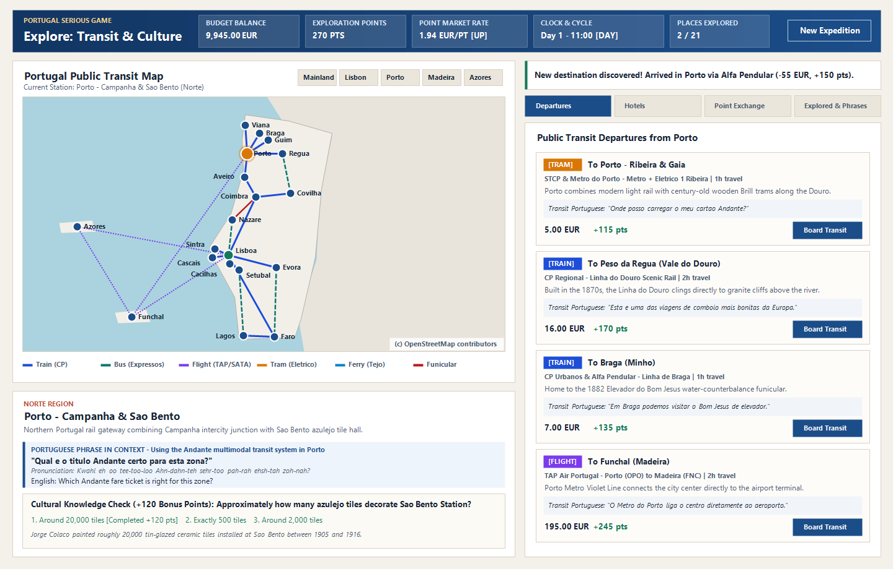

# Explore: Portugal Public Transit & Cultural Serious Game

**Explore** is an interactive educational web game built as a cartographic overlay on OpenStreetMap. Players start with **10,000.00 EUR** in Lisbon and traverse mainland Portugal, Madeira, and the Azores using authentic Portuguese public transportation while learning regional history, transit geography, and practical European Portuguese phrases.

## Screenshot



## Educational Features

- **OpenStreetMap Cartographic Overlay**: Powered by Leaflet and OpenStreetMap tiles, displaying 21 Portuguese destinations and color-coded multi-modal transit corridors across the mainland and Atlantic archipelagos.
- **Multi-Modal Portuguese Public Transit**:
  - **Train (`CP - Comboios de Portugal`, `Fertagus`)**: Alfa Pendular high-speed rail, Intercidades, Linha do Douro, Linha do Minho, Linha de Sintra, and Linha de Cascais.
  - **Bus (`Rede Expressos`, `Carris Metropolitana`)**: Intercity and coastal coach corridors connecting Alentejo, Algarve, Oeste, Serra da Estrela, and Minho.
  - **Tram (`Carris`, `STCP`, `Metro do Porto`)**: Lisbon Elétrico 28E and Porto Elétrico 1 / light rail.
  - **Ferry (`Transtejo Soflusa`)**: Tagus estuary *cacilheiro* river crossings.
  - **Funicular (`Elevador`)**: Historic hillside cable lifts such as Ascensor da Nazaré and Funicular dos Guindais.
  - **Flight (`TAP Air Portugal`, `Azores Airlines SATA`)**: Domestic aviation links to Funchal (Madeira) and Ponta Delgada (Azores).
- **European Portuguese Phrasebook**: Every arrival, transit boarding, and hotel check-in unlocks contextual Portuguese sentences with phonetic pronunciation guides and English translations.
- **Cultural Dossiers & Quizzes**: Each destination includes historical context, a public transit engineering highlight, and a knowledge check quiz worth `+120` bonus points.

## Core Simulation Mechanics

1. **Starting Budget & Exploration Points**: Players begin at `Lisboa - Gare do Oriente` at **Day 1, 08:00** with **10,000.00 EUR** and **0 Points**.
2. **Transit Fares & Clock Progression**: Boarding public transport deducts ticket fares in Euros, advances the clock by travel duration, and awards Exploration Points (plus a discovery bonus on first visit to a new location).
3. **Nightfall & Mandatory Hotel Stays**: At **20:00 (Nightfall)**, public transit halts for the night. Players must check into one of three local lodging tiers (*Pensão*, *Hotel Urbano*, or *Pousada Histórica*), paying the nightly rate in Euros to advance to **08:00** the following morning.
4. **Fluctuating Point-to-Euro Exchange Market**: Exploration Points fluctuate in monetary value (`0.75` to `3.60 EUR/pt`) after each transit leg or hotel stay. Players can convert Points back into Euros at any time via the Exchange Desk.
5. **Expedition Termination**: The game concludes when **0 EUR** and **0 Points** remain (or when combined cash and point liquidity can no longer cover the cheapest available action).

## Project Structure

- `index.html`: Main dashboard shell and Leaflet OpenStreetMap integration.
- `styles.css`: Responsive UI layout and map legend styling.
- `src/data.js`: Curated dataset of 21 Portuguese destinations, transit routes, operators, cultural notes, quizzes, and European Portuguese phrases.
- `src/engine.js`: Pure ES module simulation engine (`ExploreGameEngine`) handling transit, time/nightfall cycles, hotels, point exchange market, quizzes, and bankruptcy/termination logic.
- `src/app.js`: Browser controller binding `ExploreGameEngine` to OpenStreetMap layers and DOM panels.
- `tests/engine.test.js`: Automated unit and compliance test suite using `node --test`.

## Running Locally

Because the browser application uses standard ES modules (`<script type="module">`), serve the project directory over HTTP:

```bash
python -m http.server 8000
```

Then open `http://localhost:8000` in your browser.

## Running Tests

Requires Node.js 20+:

```bash
npm test
```

or directly:

```bash
node --test tests/engine.test.js
```
